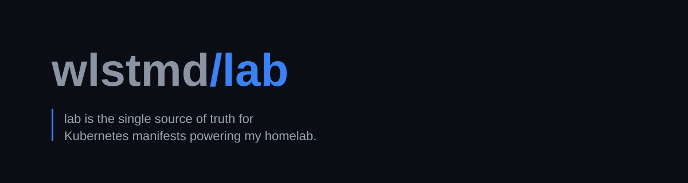

# wlstmd/lab

**lab** is the single source of truth repository containing Kubernetes resource manifest files for my Homelab GitOps environment powered by ArgoCD.

Covered domains include, but are not limited to, apex and subdomains of https://wlstmd.cloud.

An ArgoCD instance continuously monitors the `apps` folder, which contains manifest files that reference each application's manifest directory. When updates occur, these manifests trigger full resource synchronization. More information on this pattern is here: [App of Apps](https://argo-cd.readthedocs.io/en/stable/operator-manual/cluster-bootstrapping/#app-of-apps-pattern-alternative).

## Contents

This repository defines many components of the Kubernetes cluster, such as:

* HTTP Routing (Traefik, Istio Ambient Gateway)
* TLS Certificate Management/Ordering (cert-manager)
* Observability (Grafana, Prometheus)
* GitOps Delivery (ArgoCD)
* and Actual Service Components.

## Sync Status

<!-- SYNC_TABLE_START -->

<table>
  
  <tr>
  <td> </td>
  
  
  
  <td> </td>
  
  
  
  <td> </td>
  
  
  
  <td> </td>
  </tr>
  
  <tr>
  <td> </td>
  
  
  
  <td> </td>
  
  
  
  <td> </td>
  
  
  
  <td> </td>
  </tr>
  
  <tr>
  <td> </td>
  
  
  
  <td> </td>
  
  
  
  <td> </td>
  
  
  
  <td> </td>
  </tr>
  
  <tr>
  <td> </td>
  
  
  
  <td> </td>
  
  
  
  <td> </td>
  
  
  
  <td> </td>
  </tr>
  
  <tr>
  <td> </td>
  
  
  
  <td> </td>
  
  
  
  <td> </td>
  
  
  
  <td> </td>
  </tr>
  
  <tr>
  <td> </td>
  
  
</table>

<!-- SYNC_TABLE_END -->

## Rights

&copy; 2026. wlstmd. MIT Licensed.
